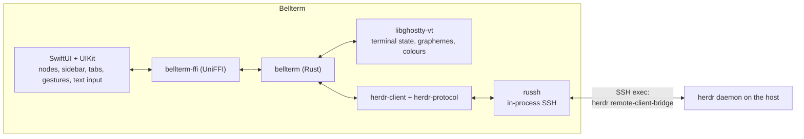

# Bellterm for iOS

Bellterm is a native iOS client for a [Herdr](https://herdr.dev/) daemon
running on a machine you reach over SSH. The name is the terminal's bell (BEL)
and the bellwether that leads a herd: it rings when an agent needs you. It is a
client only: Herdr on the host owns the terminals, workspaces, tabs, panes, and
agents, and they keep running when the phone disconnects, sleeps, or loses
signal.

> **Unaffiliated project.** Bellterm works with Herdr but is not affiliated
> with, endorsed by, or supported by Herdr or herdr.dev.

Bellterm runs on iOS 26 or newer, on iPhone and iPad, and is built for iPhone
Duo. It shares its Rust core with
[Bellterm for Android](https://github.com/nimrc/bellterm).

**Install:** join the beta on
[TestFlight](https://testflight.apple.com/join/aYFsFsRf).

## What it does

| Herdr concept | In Bellterm |
| --- | --- |
| Host and session | **Nodes** on the start screen, grouped and searchable, each with a colour label; tap one to attach. Each node names a Herdr session (`default` unless you use named sessions). |
| Workspaces | The sidebar, with branch, ahead/behind, linked worktree, and the daemon's status dot. **New workspace** at the bottom; long-press a workspace to rename or close it. |
| Tabs | The tab strip above the terminal, with each tab's status dot; **+** opens a new tab, named as you type it or numbered by Herdr when left blank. |
| Panes | Drawn as Herdr lays them out. Tap a pane to focus it; split, zoom, and close from the session menu. |
| Agents | Listed in the sidebar with **Working / Needs input / Done / Idle**; tap one to jump to its pane. The daemon's "needs input" and "finished" notifications show as banners while the app is open. |

### iPhone Duo

- **Closed**, the outer display shows one column, with the sidebar behind a
  button.
- **Open**, workspaces and agents sit beside the terminal. Toolbars move to the
  side as the system lays them out.
- **Folded like a book**, the sidebar takes the leading half, so the terminal
  and its controls stay clear of the fold.
- **Folded like a laptop**, the terminal fills the raised half and the keyboard
  with its extra keys the flat half.

Layout follows size classes and the fold's reserved region, never the hinge
angle or the device model, so the same code serves iPhone, iPad, and Split
View.

### Reaching hosts

- **Jump hosts.** A node can name another node as its jump host, which can have
  its own, as `ssh -J a,b host` does. Every hop's host key is checked and
  trusted separately; the trust prompt names the hop.
- **Keys and certificates.** **Keys & certificates** holds the device key
  generated on the phone, generated keys, and imported OpenSSH private keys
  (RSA, ECDSA, Ed25519; a passphrase is used once to decrypt). Private keys are
  Keychain items readable only on this device while it is unlocked. Attach an
  OpenSSH user certificate (`*-cert.pub`) to a key for hosts that trust a CA
  (`TrustedUserCAKeys`); Bellterm checks that it certifies the key and shows
  its principals and validity.
- **Passwords** can be saved per node, in the node editor or with **Remember
  password** when asked, in the Keychain like private keys; a hop without a
  saved password is asked for one on each connection. When a host rejects a
  saved password, the session offers **Enter password** for that hop.
- **SSH config import.** Paste or choose your `~/.ssh/config`: every `Host`
  alias becomes a node, `HostName`/`User`/`Port`/`ServerAliveInterval` are
  applied with OpenSSH's first-value-wins rules, and `ProxyJump` chains become
  jump-host nodes. `Match` and `Include` are reported, not applied; keys named
  by `IdentityFile` are imported separately.
- **Known hosts** lists trusted fingerprints by `host:port`; forgetting one
  re-prompts on the next connection. A changed key is refused with a warning.
- **Keepalive** per node keeps mobile connections from idling out.

### Appearance

- Liquid Glass throughout: the tab strip, extra keys, banners, and state card
  are glass, and the app icon is an Icon Composer icon with dark and tinted
  renditions. Light and dark follow the system or are fixed in Settings.
- English and Simplified Chinese, following the system; the app's language can
  also be set under its entry in the Settings app.
- Terminal colour schemes for dark and light separately: Bellterm, Catppuccin
  Mocha/Latte, Dracula, GitHub Light, Gruvbox, Nord, One Dark, Solarized,
  Tokyo Night. The scheme also becomes the host theme Herdr reports to pane
  programs.
- **Fonts with Nerd Font icons.** JetBrains Mono, Source Code Pro, and Ubuntu
  Mono Nerd Font Mono ship in the app in every style, so nothing is downloaded.
  Any TTF/OTF can be imported, and the system monospace face is offered too;
  for fonts without Nerd Font icons, the bundled Symbols Nerd Font draws them.

iOS conventions it follows:

- The keyboard types straight into the focused pane: no suggestions or
  autocorrect, and CJK input methods compose in place at the cursor.
- An extra-keys row rides on the keyboard: Esc, Tab, latching **Ctrl** and
  **Alt** for the next key, arrows and paging keys that repeat while held,
  symbols phone keyboards hide, and a key that lowers the keyboard.
- Drag or fling to scroll a pane, pinch to change the font size, long-press to
  select text and copy or paste from the edit menu. The bell can tap a haptic,
  and the screen can stay on during a session.
- Hardware keyboards work, including Ctrl and Alt chords and repeating keys.
- iOS suspends apps in the background, so attachments close there and reopen
  on return; Herdr keeps everything running meanwhile.

Closing a pane, tab, or workspace asks first, because Herdr ends the programs
in it.

## Signing in

On first launch Bellterm generates an Ed25519 key on the device. Add its public
key (Keys & certificates → This device → Copy) to the host:

```sh
echo 'ssh-ed25519 AAAA… bellterm@iPhone' >> ~/.ssh/authorized_keys
```

or sign it with your SSH CA and attach the certificate. The first connection to
each hop shows the host key's SHA-256 fingerprint for you to compare with
`ssh-keygen -lf /etc/ssh/ssh_host_ed25519_key.pub` on that host before trusting
it.

The host that runs Herdr needs `/bin/sh` and Herdr 0.9.0 or later in one of
the usual install locations (for example `~/.local/bin/herdr` or
`/opt/homebrew/bin/herdr`). Nothing is installed, started, or upgraded on the
host: if no Herdr server is running for the session, start one there with
`herdr`. Jump hosts need only SSH with TCP forwarding allowed.

## How it works



- **Transport.** iOS has no `ssh` executable, so the core uses
  [russh](https://crates.io/crates/russh) on a thread of its own. It runs the
  same remote bridge discovery script a desktop client runs through `ssh`, and
  answers it with `herdr_client::answer_remote_bridge`.
- **Terminal.** Herdr sends rendered cell grids, not a byte stream. Each
  surface is written into a [libghostty-vt](https://github.com/ghostty-org/ghostty)
  terminal as VT, and frames are read back from its render state: grapheme
  clusters, wide characters, colour resolution through the theme palette, and
  the cursor all come from Ghostty. A UIKit view draws those frames with Core
  Text.
- **Threads.** The Rust core owns every blocking operation and publishes only
  the latest frame and shell view, so a slow view never queues stale frames.
  Swift pulls events on a thread of its own and applies them on the main
  actor, which never blocks.

| Path | Responsibility |
| --- | --- |
| `native/src/ssh/` | Routes through jump hosts, host key pinning, key/certificate/password auth, bridge pump |
| `native/src/config.rs` | The route document the app sends, parsed into zeroizing types |
| `native/src/keys.rs` | Key generation and import, certificate inspection |
| `native/src/ssh_config.rs` | OpenSSH client configuration import |
| `native/src/vt.rs` | Herdr cells (and popups) as VT for libghostty |
| `native/src/screen.rs`, `render.rs` | libghostty terminal; frames packed for the app |
| `native/src/session.rs` | Connection, event mailboxes, input routing |
| `native/src/input.rs` | Key codes and touches as Herdr semantic input |
| `ffi/src/lib.rs` | The Swift surface: free functions and the `Session` object |
| `app/Bellterm/Core` | `Connection`, frame and shell-view parsing, route documents, key mapping |
| `app/Bellterm/UI` | SwiftUI screens and the `TerminalUIView` |
| `crates/herdr-client`, `crates/herdr-protocol` | Herdr's wire protocol and client worker (Apache-2.0, see `NOTICE`) |

## Building

Requirements: Xcode 27.1 or newer, [XcodeGen](https://github.com/yonaskolb/XcodeGen),
pkg-config, Rust with the `aarch64-apple-ios` and `aarch64-apple-ios-sim`
targets, and **Zig 0.15.2**, which `libghostty-vt-sys` uses to build Ghostty
(the pinned Ghostty commit requires exactly that version).

```sh
just test       # Rust core tests on the host
just core       # app/Generated: the core as an xcframework, and its Swift bindings
just project    # gathers the bundled fonts, then app/Bellterm.xcodeproj
just test-app   # Swift tests on an iPhone simulator
```

`libghostty-vt-sys` has no iOS target, so `scripts/build-core.sh` builds
Ghostty natively with its xcframework enabled, takes the iOS device and
simulator archives from it, and points the crate's `pkg-config` feature at
them.

Zig 0.15.2 cannot link against the libSystem stubs of macOS SDK 26.5 and
later, and does not run on macOS 27 at all, so `just core` needs Xcode 26.0
selected on a macOS 26 host. CI builds the core that way and uploads it as the
`bellterm-ios-core` artifact; elsewhere, download it instead:

```sh
gh run download <run-id> -n bellterm-ios-core -D app/Generated
```

To run on a device, open `app/Bellterm.xcodeproj` and pick your team, or build
from the command line:

```sh
cd app
xcodebuild -scheme Bellterm -destination 'id=<device-udid>' \
  DEVELOPMENT_TEAM=<team-id> -allowProvisioningUpdates
xcrun devicectl device install app --device <device-udid> \
  ~/Library/Developer/Xcode/DerivedData/Bellterm-*/Build/Products/Debug-iphoneos/Bellterm.app
```

## Limitations

- iOS suspends background apps, so attachments close while Bellterm is in the
  background and agent notifications arrive only while it is open.
- Inline images (Kitty graphics, Sixel) are not drawn yet.
- Hosts that only offer PowerShell (Windows OpenSSH) are not supported.
- Generated keys are Ed25519; RSA and ECDSA keys can be imported but not
  generated. FIDO/security-key (`sk-`) keys and SSH agents are not supported.
- `Match` and `Include` in imported SSH configuration are not evaluated.

## License

Bellterm is released under the [Apache License 2.0](LICENSE). The Herdr
protocol and client crates in `crates/` are third-party code under the same
licence with their own copyright, and the bundled fonts keep their own
licences; [NOTICE](NOTICE) lists each of them.
